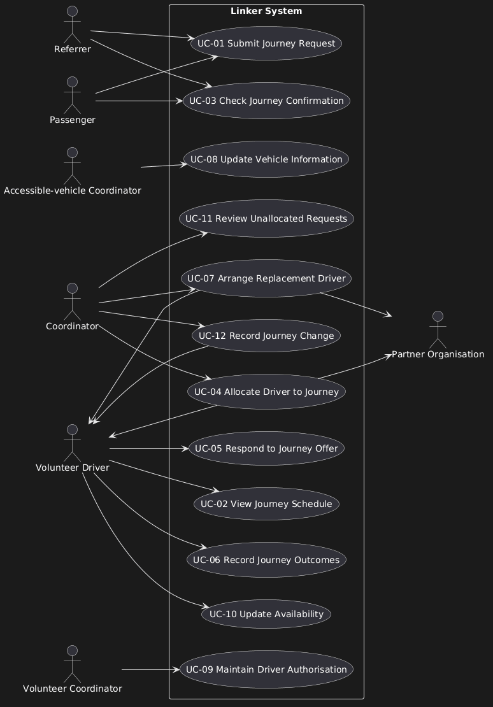

 # 04 – Use-Case Model

## System Boundary
<!-- One or two lines: what Linker System covers, and what's outside (emergency transport, vehicle tracking) -->

## Actors

| Actor                          | Type                 | Main goals                                                                                                               | Evidence / assumption                                                                                                                                    |
| ------------------------------ | -------------------- | ------------------------------------------------------------------------------------------------------------------------ | -------------------------------------------------------------------------------------------------------------------------------------------------------- |
| Coordinator                    | Primary              | Assign vehicles and drivers to a journey, review unallocated requests and unmet demand and arrange a replacement driver. | A-02, Q-05, E-09                                                                                                                                         |
| Volunteer Driver               | Primary / Supporting | View current journey schedule, respond to journey offer, update availability and record journey outcome.                 | E-01, E-03, E-05, C-03, A-13                                                                                                                             |
| Passenger                      | Primary / Supporting | Request a journey and check journey confirmation.                                                                        | Q-02, E-06                                                                                                                                               |
| Referrer                       | Primary / Supporting | Request a journey on a passenger's behalf and check journey confirmation.                                                | A-05, Q-02, P-08                                                                                                                                         |
| Accessible-vehicle coordinator | Primary              | Update vehicle information.                                                                                              | A-12, Stakeholder evidence ("The vehicle can be free while no authorised driver is available."), Volunteer drivers and availability                      |
| Volunteer Coordinator          | Primary              | Maintain driver authorisation, training status and review drivers.                                                       | A-12, P-04, Stakeholder evidence ("We cannot tell whether a driver declined, was unavailable or was never contacted."), Organisation and current service |
| Partner Organisation           | Supporting           | Occasionally provide accessible vehicles that may be needed for suitable journeys.                                       | Organisation and current service, paragraph 1                                                                                                            |

## Offstage Stakeholders

| Stakeholder          | Interest                                                                                          | How it affects requirements                                                                      |
| -------------------- | ------------------------------------------------------------------------------------------------- | ------------------------------------------------------------------------------------------------ |
| Kerry Community Link | Reliable coordination of journeys, accurate records and visibility of unmet demand.               | Journey request management, driver matching, workload monitoring and incomplete journey records. |
| Passenger Companion  | Passengers receive reliable arrangements, and any companion's involvement is properly considered. | Journey confirmations, passenger requirements, accessibility needs and companion arrangements.   |

## Use-Case Diagram

Source: `diagrams/use-case-model.puml`

## Use-Case Catalogue

| ID    | Name                          | Primary actor                  | Supporting actors                      | Goal                                                                                                                                                                                                                                 | FRs                  | Priority |
| ----- | ----------------------------- | ------------------------------ | -------------------------------------- | ------------------------------------------------------------------------------------------------------------------------------------------------------------------------------------------------------------------------------------ | -------------------- | -------- |
| UC-01 | Submit Journey Request        | Passenger / Referrer           | N/A                                    | Submit a journey request (one-way, recurring, return) with information (locations, times, assistance needs) so that it can be recorded and considered for allocation.                                                                | FR-01, FR-03         | Must     |
| UC-02 | View Journey Schedule         | Volunteer Driver               | N/A                                    | View current journey schedule with collection, contact and assistance information.                                                                                                                                                   | FR-08                | Should   |
| UC-03 | Check Journey Confirmation    | Passenger  / Referrer          | N/A                                    | Check journey confirmation, so that the Passenger knows the collection details and whether the return journey is confirmed.                                                                                                          | FR-09                | Must     |
| UC-04 | Allocate Driver to Journey    | Coordinator                    | Volunteer Driver, Partner Organisation | Assign a driver and vehicle that suit the passenger's needs and the journey.                                                                                                                                                         | FR-04, FR-05         | Must     |
| UC-05 | Respond to Journey Offer      | Volunteer Driver               | N/A                                    | Accept or decline the offer. A reason is not required for declining the offer. The response is recorded so the coordinator knows whether the journey is confirmed or still needs a driver.                                           | FR-10 (BR-02), FR-13 | Must     |
| UC-06 | Record Journey Outcomes       | Volunteer Driver               | N/A                                    | Record collection, arrival, return times and outcome including a reason if it was unsuccessful so that the coordinator has complete and consistent journey records.                                                                  | FR-07                | Must     |
| UC-07 | Arrange Replacement Driver    | Coordinator                    | Partner Organisation, Volunteer Driver | When the allocated driver becomes unavailable, allocate a replacement driver who meets the passenger and vehicle requirements.                                                                                                       | FR-11                | Should   |
| UC-08 | Update Vehicle Information    | Accessible-vehicle Coordinator | N/A                                    | Record which accessible vehicles exist, when they are available and their capabilities so that allocation only proposes vehicles that suit the passenger.                                                                            |                      | Could    |
| UC-09 | Maintain Driver Authorisation | Volunteer Coordinator          | N/A                                    | Record each driver's completed checks and training and whether they're authorised for accessible vehicles and when their documentation expires, so that allocation only proposes drivers whose checks and documentation are current. |                      | Could    |
| UC-10 | Update Availability           | Volunteer Driver               | N/A                                    | Update their usual availability, preferred areas, maximum distance and vehicle limitations which can change weekly, so that allocation only proposes drivers who are actually available.                                             | FR-02                | Must     |
| UC-11 | Review Unallocated Requests   | Coordinator                    | N/A                                    | Review journey stages, provisional offers, recurring unmet demand and incomplete records, so that the coordinator can see what still needs action and where demand isn't being met.                                                  | FR-12                | Should   |
| UC-12 | Record Journey Change         | Coordinator                    | Volunteer Driver                       | Record journey changes, then contact affected driver, so that the driver is up to date with their schedule.                                                                                                                          | FR-06                | Must     |
UC-08, UC-09 and UC-10 set to could as no FR fit the criteria at this time.
UC-09 assumes authorisation records exist and drivers' maintenance is deferred.

## Detailed Use Case: UC-04 Allocate Driver to Journey

| Field                      | Detail                                                                                                                                                                                                                                                            |
| -------------------------- | ----------------------------------------------------------------------------------------------------------------------------------------------------------------------------------------------------------------------------------------------------------------- |
| ID                         | UC-04                                                                                                                                                                                                                                                             |
| Name                       | Allocate Driver to Journey                                                                                                                                                                                                                                        |
| Level                      | User goal                                                                                                                                                                                                                                                         |
| Primary actor              | Coordinator                                                                                                                                                                                                                                                       |
| Supporting actors          | Volunteer Driver, Partner Organisation                                                                                                                                                                                                                            |
| Stakeholders and interests | **Kerry Community Link**: Only authorised drivers with current checks are used. **Passenger/Referrer**: A driver and vehicle that suits their needs, and a confirmed return journey. **Volunteer Driver**: No overlapping commitments, and free to decline. |
| Preconditions              | A journey request is recorded with status 'unallocated'.  Driver and vehicle records exist.                                                                                                                                                                    |
| Trigger                    | Coordinator selects an unallocated journey request to allocate.                                                                                                                                                                                                   |
| Postconditions (success)   | A suitable driver and vehicle are provisionally offered, and the journey status is provisional.                                                                                                                                                                   |
| Related requirements       | FR-04, FR-05, FR-13                                                                                                                                                                                                                                               |
| Related business rules     | BR-02, BR-03, BR-07                                                                                                                                                                                                                                               |

### Main Success Scenario
1. Coordinator selects an unallocated journey request.
2. System shows the request details, needs, times and locations. 
3. System proposes drivers and vehicles that suit the request, where drivers have valid current checks and authorisation for the vehicle, are available and have no overlapping journeys (FR-04, FR-05).
4. Coordinator chooses a driver and vehicle.
5. System records the provisional offer and sends it to the driver.
6. System sets the journey status to provisional.

### Extensions
- **3a.** If there is no suitable driver, the coordinator places the passenger on a waiting list or inform the passenger no journey is available. Use case ends.
- **3b.** If there is no suitable vehicle, contact the partner for an accessible vehicle. If one is provided, resume at step 3; otherwise go to 3a.
- **3c.** A vehicle is available but no authorised driver is available. Coordinator seeks a partner driver or follows 3a.
- **3d.** The passenger could share a journey with another booking (Q-02)(BR-08). Otherwise coordinator confirms the passenger agrees to share before the journeys are combined (Q-02). If they don't agree, resume at step 4
- **4a.** Coordinator attempts to select a familiar driver whose checks have expired, the system rejects the selection and shows the expired check (BR-03). Resume at step 3.
- **5a.** Driver doesn't use email/app. Coordinator phones the driver instead and records that the offer was made. Resume at step 6.

### Exceptions
- Passenger cancels the request during the allocation. The coordinator records the cancellation, any provisional offer is withdrawn and the use case ends with the request recorded as 'cancelled'.
- The driver's checks expire after the offer is sent but before the journey happens. The offer is withdrawn and the request returns to 'unallocated'.

### Open Issues
- **Q-02**: Is consent to journey sharing general or required for each journey? (Affects 3d)
- **Q-01**: Who has priority when demand exceeds available drivers? (Affects 3a)
- **Q-07**: When does a provisional offer reserve a driver? (Affects 5)
- **Q-06**: What information can be shared with drivers and partner organisations? (Affects 5 and 3b)
- **Q-08**: How many drivers lack digital access? (Affects 5a)