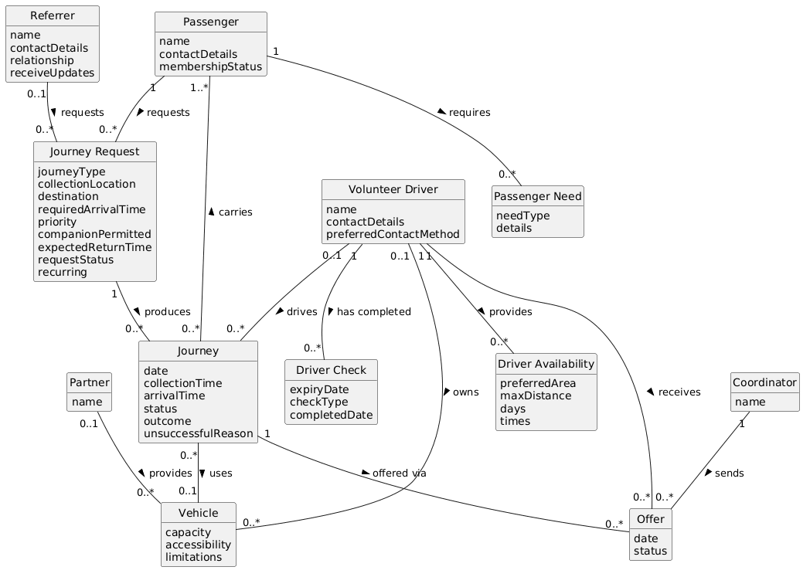

# 06 – Domain Model and Rationale

## Purpose
This file models the information Linker System must hold, as a conceptual domain model with no methods, IDs or navigability.

## Domain Model Diagram

Source: `diagrams/domain-model.puml`

## Classes and Attributes

| Class               | Key attributes                                                                                                                                  | From candidates                          |
| ------------------- | ----------------------------------------------------------------------------------------------------------------------------------------------- | ---------------------------------------- |
| Journey             | `date, collectionTime, arrivalTime, status, outcome, unsuccessfulReason`                                                                        | CC-21, CC-26, CC-29, CC-30, CC-31        |
| Journey Request     | `journeyType, collectionLocation, destination, requiredArrivalTime, priority, companionPermitted, expectedReturnTime, requestStatus, recurring` | CC-12, CC-13, CC-14, CC-11, CC-27, CC-35 |
| Volunteer Driver    | `name, contactDetails, preferredContactMethod`                                                                                                  | CC-06, CC-07, CC-32                      |
| Driver Check        | `expiryDate, checkType, completedDate`                                                                                                          | CC-22, CC-23                             |
| Driver Availability | `preferredArea, maxDistance, days, times`                                                                                                       | CC-16, CC-17, CC-18                      |
| Passenger           | `name, contactDetails, membershipStatus`                                                                                                        | CC-01, CC-03, CC-33                      |
| Passenger Need      | `needType, details`                                                                                                                             | CC-15, CC-24                             |
| Coordinator         | `name`                                                                                                                                          | CC-04                                    |
| Offer               | `date, status`                                                                                                                                  | CC-36                                    |
| Vehicle             | `capacity, accessibility, limitations`                                                                                                          | CC-20, CC-19, CC-38                      |
| Partner             | `name`                                                                                                                                          | CC-10                                    |
| Referrer            | `name, contactDetails, relationship, receiveUpdates`                                                                                            | CC-05, CC-08, CC-09                      |

## Associations

| ID     | Class A          | Association   | Class B             | Multiplicity (A–B) | Evidence / assumption                                                         |
| ------ | ---------------- | ------------- | ------------------- | ------------------ | ----------------------------------------------------------------------------- |
| ASC-01 | Passenger        | Requests      | Journey Request     | `1 – 0..*`         | A passenger may request a one-way journey, return journey or recurring series |
| ASC-02 | Passenger        | Requires      | Passenger Need      | `1 - 0..*`         | Passengers may need wheelchair space, room for a walking aid ...              |
| ASC-03 | Volunteer Driver | Receives      | Offer               | `1 - 0..*`         | A driver may be offered several compatible journeys                           |
| ASC-04 | Volunteer Driver | Has Completed | Driver Check        | `1 - 0..*`         | Drivers have completed different checks and training                          |
| ASC-05 | Coordinator      | Sends         | Offer               | `1 - 0..*`         | Volunteer coordinator: can't tell if a driver was “never contacted            |
| ASC-06 | Volunteer Driver | Provides      | Driver Availability | `1 - 0..*`         | Volunteer drivers provide usual availability… may change weekly               |
| ASC-07 | Referrer         | Requests      | Journey Request     | `0..1 - 0..*`      | Requests are sometimes submitted by relatives or community workers            |
| ASC-08 | Journey Request  | Produces      | Journey             | `1 - 0..*`         | one-way journey, return journey or recurring series                           |
| ASC-09 | Journey          | Carries       | Passenger           | `0..* - 1..*`      | Passengers travelling to nearby destinations may share a journey              |
| ASC-10 | Volunteer Driver | Drives        | Journey             | `0..1 - 0..*`      | Volunteer drivers use their own cars                                          |
| ASC-11 | Journey          | Uses          | Vehicle             | `0..* - 0..1`      | Coordinators consider ... vehicle suitability                                 |
| ASC-12 | Journey          | Offered via   | Offer               | `1 - 0..*`         | repeated unsuccessful offers, provisional offers are recorded inconsistently  |
| ASC-13 | Volunteer Driver | Owns          | Vehicle             | `0..1 - 0..*`      | Volunteer drivers use their own cars                                          |
| ASC-14 | Partner          | Provides      | Vehicle             | `0..1 - 0..*`      | partner organisations occasionally provide accessible vehicles                |

## Modelling Rationale
- I decided that the Journey Request can have a 1 to none or many relationship with the Journey because a request can exist before any journey is arranged (CC-27), and the type of the journey can dictate how many actual journeys will take place (return = 2, recurring makes a journey each time it repeats). 
- I decided that the Driver Check will be a class because a driver can have several checks, with their own type and expiry date (BR-03, FR-05, UC-09).
- I decided on a direct Journey - Passenger link because a shared journey carries passengers from different requests.
- I decided that Volunteer Driver was kept small on purpose, as availability, checks and vehicles are separate classes because a driver can have several of each, which change independently.
- I decided that the Coordinator was kept through Offer because the business needs to know who sent each offer (for example; volunteer coordinator: "can't tell whether a driver was ‘never contacted'").

## Assumptions and Open Questions
- A driver may be recorded before their checks are complete. The scenario doesn't say whether that is allowed (ASC-04).
- A request has at most one referrer. The scenario doesn't rule out a relative and a community worker both being involved (ASC-07).
- Shared journeys are allowed only with the passenger’s explicit agreement (BR-08). Whether consent is general or per journey is unresolved (Q-02) (ASC-09).
- Passenger Need is one record per passenger, not a shared type (ASC-02).
- I left out Contribution Management as it was unclarified on what the policy stated for it (Q-11). 